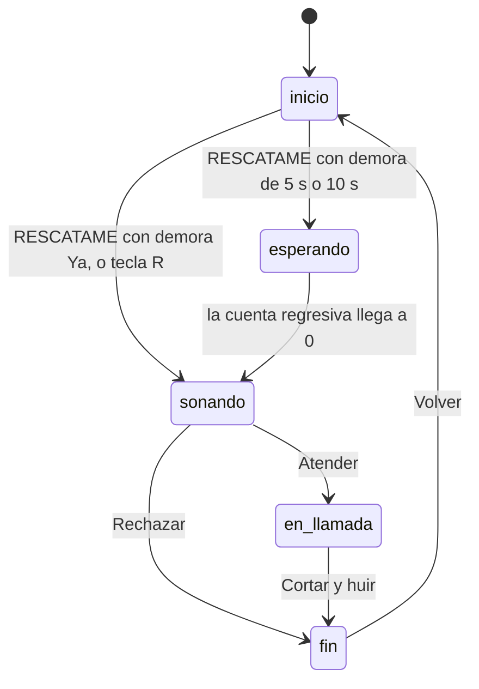

# 🚨 Llamada de Rescate

[](https://github.com/MicaelaFrancoTorres/llamada-de-rescate/actions/workflows/ci.yml)

> Un botón de emergencia para huir con dignidad de cualquier lugar donde no querés estar.

**Pabellón:** Molestias Cotidianas · **Ingrediente improbable:** Botón de emergencia

## Índice
- [El problema](#el-problema)
- [La solución](#la-solución)
- [Características](#características)
- [Máquina de estados](#máquina-de-estados)
- [Niveles y lugares](#niveles-y-lugares)
- [Cómo probarlo](#cómo-probarlo)
- [Tests](#tests)
- [Estructura](#estructura)
- [Decisiones técnicas](#decisiones-técnicas)
- [Teoría de la cursada aplicada](#teoría-de-la-cursada-aplicada)
- [Herramientas de IA utilizadas](#herramientas-de-ia-utilizadas)
- [Mejoras futuras](#mejoras-futuras)
- [Autora](#autora)

## El problema
Todos quedamos alguna vez atrapados en un cumpleaños aburrido, una reunión familiar eterna, una cita que va mal, una clase que no termina más, un asado que dura seis horas, una reunión de consorcio o una sala de espera. Nos queremos ir, pero irse sin más queda mal, y inventar una excusa en el momento sale peor: nos ponemos nerviosos, nos contradecimos y nadie nos cree.

Lo que falta no es solo una excusa. Falta que alguien más *parezca* sostenerla: una llamada que los demás vean y escuchen, con alguien que habla como habla de verdad quien llama en esa situación.

## La solución
Elegís dónde estás y cuántas ganas tenés de irte, apretás **RESCATAME** y tu pantalla recibe una **llamada entrante falsa**, con timbre y avatar que vibra. Al atender, empieza una **conversación por turnos**, como un chat: quien llama habla (y se lo escucha con voz), y a vos te marca qué decir en cada momento. Cuando termina, te muestra los **pasos de escape** y el botón para cortar.

Lo distinto: todo se adapta al lugar y a tu desesperación. Cuantas más ganas tenés de irte, más dramática es la excusa y más rápido salís, aunque sea menos creíble.

## Características
- 📍 **Ocho lugares**, cada uno con su propio llamador, su excusa y su diálogo.
- 🎚️ **Tres niveles de desesperación** (suave, medio y extremo) que cambian la excusa, los pasos, la credibilidad y el tiempo de escape.
- 🗣️ **Conversación por turnos** con burbujas de chat: quien llama a la izquierda, vos a la derecha.
- 🔊 **Voz** para toda la conversación (`speechSynthesis`): cada personaje con su tono y velocidad, y tus respuestas con una voz distinta.
- ⏳ **Demora configurable**: la llamada suena ya, a los 5 s o a los 10 s, con cuenta regresiva.
- 👤 **Nombre personalizado**: elegís quién te llama (hasta 20 caracteres).
- 🏆 **Historial** de escapes y rechazos, guardado en el navegador.
- ⌨️ **Atajo secreto**: la tecla **R** dispara el rescate.
- ♿ **Accesible**: HTML semántico, uso completo con teclado, foco visible y botones de 44 px como mínimo.
- 🧪 **Con tests y CI**: la lógica está probada y GitHub Actions corre los tests en cada push.

## Máquina de estados

Cualquier otra transición es inválida y se ignora. El estado `en_llamada` aparece como `en-llamada` en el código.

## Niveles y lugares
**Niveles** (regla R1 y R3):

| Ganas | Nivel | Credibilidad | Tiempo de escape | Estilo de la excusa |
|---|---|---|---|---|
| 1 a 3 | Suave | 94 − ganas | 120 s | Tranquila y creíble |
| 4 a 7 | Medio | 78 − ganas | 45 s | Un imprevisto |
| 8 a 10 | Extremo | 52 − ganas | 12 s | Una catástrofe |

**Lugares y llamadores** (regla R2):

| Lugar | Llama |
|---|---|
| 🎂 Cumpleaños | Mamá |
| 👵 Reunión familiar | Vecina Marta |
| 💔 Cita | Mejor amiga |
| 💼 Trabajo | Soporte Técnico |
| 📚 Clase aburrida | Hermano/a |
| 🍖 Asado eterno | Abuela |
| 🏢 Reunión de consorcio | Cerrajero |
| 🩺 Sala de espera | Trabajo |

## Cómo probarlo
Descargá el repositorio y abrí `index.html` en el navegador (doble clic, no hace falta instalar nada). Para la voz conviene Chrome o Edge.

| Escenario | Qué hacer | Qué debería pasar |
|---|---|---|
| E1 | Tocar RESCATAME sin elegir lugar | Aparece "⚠️ Primero elegí dónde estás" y no cambia de pantalla |
| E2 | Elegir Cumpleaños y tocar RESCATAME | Suena una llamada de "Mamá" y el avatar vibra |
| E3 | Elegir Cita, ganas 9, atender y esperar el final | Excusa extrema, "Credibilidad: 43%" y "Escape en 12 s" |
| E4 | Rechazar mientras suena | Se corta el sonido y dice "Rechazaste tu propio rescate" |
| E5 | Cortar al terminar la conversación | Se frena el contador y dice "¡Escapaste con éxito!" |
| E6 | Volver desde el final | Volvés al inicio con tu lugar y tus ganas sin cambiar |
| E7 | Atender una llamada | Las burbujas aparecen de a una, se leen en voz alta y al final salen los pasos y el botón Cortar |
| E8 | Atender y esperar los 5 turnos | Se lee todo en orden, y tus frases suenan con otra voz |
| E9 | Elegir "5 s" y tocar RESCATAME | Cuenta regresiva en pantalla y a los 5 s suena |
| E10 | Elegir Asado eterno y atender | Llama "Abuela" |
| E11 | Cortar una llamada y rechazar otra | El historial muestra 1 escape y 1 rechazo, y se mantiene al recargar |
| E12 | Tocar la tecla **R** en el inicio | Se dispara el rescate (sin lugar, usa Cumpleaños) |
| E13 | Escribir "Tía Rosa" en el nombre | Llama "Tía Rosa" en lugar del llamador del lugar |
| E14 | Hacer push a `main` | El workflow CI corre los tests (pestaña Actions) |

## Tests
Requieren Node 18 o superior:

```
npm test
```
Cubren las reglas R1 a R9 de `rescate.js`: niveles y límites (1, 3, 4, 7, 8 y 10), llamadores de los 8 lugares, credibilidad y tiempo, entradas inválidas, diálogos de 5 turnos que alternan, historial sin mutación y nombre personalizado. En GitHub, el workflow `CI` los corre solos en cada push y pull request.

## Estructura
| Archivo | Qué hace |
|---|---|
| `index.html` | Las dos pantallas, con HTML semántico y accesible |
| `style.css` | Diseño con variables CSS, Grid y Flexbox, y animaciones |
| `rescate.js` | Lógica pura: lugares, diálogos y funciones `armarRescate`, `registrarResultado` y `limpiarNombre` |
| `app.js` | Interfaz: `estado`, `render()`, transiciones, voz, historial y atajo |
| `rescate.test.js` | Tests de las reglas R1 a R9 |
| `SPEC.md` | Especificación completa (reglas, estados, escenarios y trazabilidad) |
| `.github/workflows/ci.yml` | Integración continua con GitHub Actions |
| `package.json` | Script `npm test` |

## Decisiones técnicas
- **Sin frameworks ni instalación**: HTML, CSS y JavaScript puro, se abre con doble clic.
- **Lógica pura separada de la interfaz**: `rescate.js` no toca el DOM, por eso se testea con Node. `app.js` solo dibuja el estado.
- **Patrón estado → render**: los datos viven en `estado` y `render()` dibuja la pantalla. Las transiciones válidas están en una tabla (`TRANSICIONES`).
- **Diálogos que alternan por construcción**: `armarDialogo` asigna "llama" y "vos" según la posición, así ningún diálogo puede romper la alternancia.
- **Voz con plan B**: si el navegador no tiene `speechSynthesis`, cada turno espera 2,5 s. Un identificador de sesión ignora los avisos tardíos de la voz cuando se corta o se rechaza.
- **Audio habilitado en el clic**: el navegador solo deja sonar con un gesto del usuario, así que el audio se crea y reanuda en el clic aunque suene 10 s después.
- **Inmutabilidad**: `registrarResultado` devuelve un objeto nuevo y no modifica el historial recibido.
- **`localStorage` defensivo**: todo acceso va en `try/catch`. Si está bloqueado o tiene datos rotos, el historial arranca en 0 y la app funciona igual.
- **Atajo R solo fuera de campos de texto**: así no se dispara mientras se escribe el nombre.

## Teoría de la cursada aplicada
| Clase | Dónde se aplica |
|---|---|
| 3 · HTML semántico y WCAG | `main`, `section`, `header`, `article`, `fieldset`/`legend`, `label`, `aria-label`, `aria-live`, `role="alert"`, foco visible, 44 px mínimos |
| 4 · CSS moderno | Variables CSS, Grid para las opciones, Flexbox para la llamada y el chat, `box-sizing`, media query y animaciones |
| 5 · JavaScript base | `const`/`let`, `===`, arrow functions, template literals, `??` y `??=`, `trim` y `setInterval` |
| 6 · DOM | `querySelector`, `addEventListener`, estado → render, eventos de teclado, `speechSynthesis` y `localStorage` |
| 7 · Arrays | `find`, `map`, `includes`, `forEach`, `slice` |
| 8 · Objetos | `LUGARES` como array de objetos con `dialogos` anidados, desestructuración y spread |
| 32 · SDD | `SPEC.md`: reglas, estados y transiciones, Given/When/Then y trazabilidad |
| 38 / 41 · Testing | `rescate.test.js` con estructura AAA, casos borde, `node --test` y CI |

## Herramientas de IA utilizadas
**Claude (Anthropic)** me ayudó a:
- leer las bases, generar y comparar ideas;
- redactar la spec siguiendo SDD;
- escribir el código, los diálogos y los tests;
- armar este README y el workflow de CI.

**Lo que decidí yo:**
- la **idea** y el **pabellón** (Molestias Cotidianas);
- el **ingrediente improbable**: el botón de emergencia;
- qué mejoras sumar y en qué orden;
- las **pruebas**: abrí la aplicación en el navegador y probé los escenarios;
- la **revisión** del código y de lo que generó la IA, antes de entregarlo.

## Mejoras futuras
- Instalarla como app (PWA) para que funcione sin conexión desde el celular.
- Vibración real del teléfono con `navigator.vibrate`.
- Más lugares, y diálogos que usen el nombre personalizado.
- Elegir la voz y la velocidad de lectura.
- Tests automáticos de la interfaz.
- Versión en otros idiomas.

## Autora
**Micaela Franco Torres** · [github.com/MicaelaFrancoTorres](https://github.com/MicaelaFrancoTorres)
