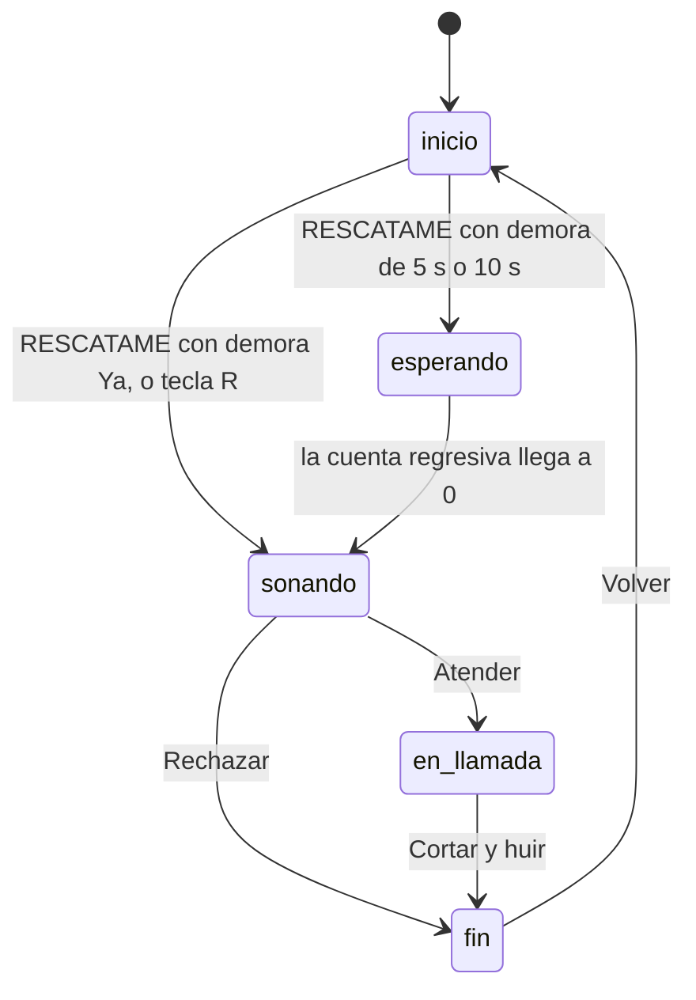

# Llamada de Rescate

[](https://github.com/MicaelaFrancoTorres/llamada-de-rescate/actions/workflows/ci.yml)

**Pabellón:** Molestias Cotidianas

**Ingrediente improbable:** Botón de emergencia

## Índice
- [El problema](#el-problema)
- [La solución](#la-solución)
- [Características](#características)
- [Máquina de estados](#máquina-de-estados)
- [Niveles y lugares](#niveles-y-lugares)
- [Cómo probarlo](#cómo-probarlo)
- [Tests](#tests)
- [Estructura](#estructura)
- [Decisiones técnicas](#decisiones-técnicas)
- [Teoría de la cursada aplicada](#teoría-de-la-cursada-aplicada)
- [Herramientas de IA utilizadas](#herramientas-de-ia-utilizadas)
- [Mejoras futuras](#mejoras-futuras)
- [Autora](#autora)

## El problema
Elegí este problema porque nos pasó a todos: estás en un cumpleaños, una reunión familiar, una cita que no va bien o una sala de espera, y te querés ir, pero levantarte sin más queda mal. Inventar una excusa en el momento sale peor, porque te ponés nervioso y nadie te cree. Lo que me pareció que faltaba era que alguien más sostenga la excusa: una llamada que los demás puedan ver y escuchar.

## La solución
La app es un botón de emergencia. Elegís dónde estás y cuántas ganas tenés de irte, apretás RESCATAME y la pantalla simula una llamada entrante, con timbre y un avatar que vibra. Si atendés, empieza una conversación de cinco turnos que se va mostrando como un chat y se lee en voz alta. Quien llama habla con la voz de su personaje, y tus respuestas suenan con una voz distinta. Al terminar aparecen los pasos para escaparte y el botón para cortar.

Cuantas más ganas tenés de irte, más dramática es la excusa y más rápido salís, aunque sea menos creíble.

## Características
- Ocho lugares, cada uno con su llamador, su excusa y su diálogo.
- Tres niveles de desesperación: suave, medio y extremo.
- Conversación por turnos con burbujas de chat: quien llama a la izquierda y vos a la derecha.
- Voz propia para cada personaje, y otra voz para tus respuestas.
- Demora configurable: la llamada suena ya, a los 5 segundos o a los 10, con cuenta regresiva.
- Nombre personalizado para quien llama, de hasta 20 caracteres.
- Historial de escapes y rechazos, guardado en el navegador.
- Atajo de teclado secreto: la tecla R dispara el rescate.
- Se puede usar todo con el teclado, con foco visible y botones de 44 píxeles como mínimo.

## Máquina de estados

Cualquier otra transición es inválida y se ignora. En el código el estado `en_llamada` se llama `en-llamada`.

## Niveles y lugares
Las ganas definen el nivel (reglas R1 y R3):

| Ganas | Nivel | Credibilidad | Tiempo de escape | Tipo de excusa |
|---|---|---|---|---|
| 1 a 3 | Suave | 94 - ganas | 120 s | Tranquila y creíble |
| 4 a 7 | Medio | 78 - ganas | 45 s | Un imprevisto |
| 8 a 10 | Extremo | 52 - ganas | 12 s | Una emergencia |

Cada lugar tiene un llamador fijo y una voz propia (reglas R2 y R10). El tono y la velocidad son los valores de `speechSynthesis`:

| Lugar | Llama | Tono | Velocidad |
|---|---|---|---|
| Cumpleaños | Mamá | 1,2 | 1 |
| Reunión familiar | Vecina Marta | 1,3 | 0,9 |
| Cita | Mejor amiga | 1,4 | 1,1 |
| Trabajo | Soporte Técnico | 0,7 | 1 |
| Clase aburrida | Hermano/a | 1,1 | 1,15 |
| Asado eterno | Abuela | 1,3 | 0,8 |
| Reunión de consorcio | Cerrajero | 0,6 | 0,95 |
| Sala de espera | Trabajo | 0,8 | 1,05 |

## Cómo probarlo
1. Abrí la demo en https://micaelafrancotorres.github.io/llamada-de-rescate/ o descargá el repositorio y abrí index.html con doble clic.
2. Elegí dónde estás, mové la barra de ganas de irte y apretá el botón rojo RESCATAME.
3. Al final debería sonar una llamada entrante: al atender se escucha a quien llama, aparece la conversación con lo que tenés que responder y, cuando termina, el guion de escape y el botón para cortar.

No hay que instalar nada. Para escuchar las voces probalo en Chrome o Edge. Estos son los escenarios que fui probando:

| Escenario | Qué hacer | Qué tiene que pasar |
|---|---|---|
| E1 | Tocar RESCATAME sin elegir lugar | Aparece el aviso "Primero elegí dónde estás" y no cambia de pantalla |
| E2 | Elegir Cumpleaños y tocar RESCATAME | Suena una llamada de "Mamá" y el avatar vibra |
| E3 | Elegir Cita con ganas 9, atender y esperar el final | Se ve la excusa extrema, "Credibilidad: 43%" y "Escape en 12 s" |
| E4 | Rechazar mientras suena | Se corta el sonido y dice "Rechazaste tu propio rescate" |
| E5 | Cortar cuando termina la conversación | Se frena el contador y dice "¡Escapaste con éxito!" |
| E6 | Tocar Volver desde el final | Volvés al inicio con el lugar y las ganas que habías elegido |
| E7 | Atender una llamada | Las burbujas aparecen de a una, se leen en voz alta y al final salen los pasos y el botón Cortar |
| E8 | Atender y esperar los cinco turnos | Se lee todo en orden y tus frases suenan con otra voz |
| E9 | Elegir 5 s y tocar RESCATAME | Hay una cuenta regresiva y a los 5 segundos suena |
| E10 | Elegir Asado eterno y atender | Llama la Abuela |
| E11 | Cortar una llamada y rechazar otra | El historial marca 1 escape y 1 rechazo, y se mantiene al recargar |
| E12 | Tocar la tecla R en el inicio | Se dispara el rescate; si no elegiste lugar, usa Cumpleaños |
| E13 | Escribir "Tía Rosa" en el nombre | Llama "Tía Rosa" en lugar del llamador del lugar |
| E14 | Hacer push a `main` | El workflow CI corre los tests (pestaña Actions) |
| E15 | Atender con Asado eterno y con Reunión de consorcio | La Abuela suena aguda y lenta, y el Cerrajero grave |
| E16 | Leer un diálogo completo | Cada respuesta contesta lo que dijo quien llama |
| E17 | Recorrer la app con Tab | Todos los controles tienen foco visible y los botones con ícono tienen nombre |

## Tests
Hace falta Node 18 o superior:

```
npm test
```
Los tests cubren las reglas de lógica pura de `rescate.js`: los niveles y sus límites (1, 3, 4, 7, 8 y 10), los llamadores y las voces de los ocho lugares, la credibilidad y el tiempo, las entradas inválidas, los diálogos de cinco turnos que alternan, el español rioplatense de los textos, el historial sin mutación, el nombre personalizado y la elección de voces. En GitHub, el workflow `CI` los corre solo en cada push y pull request.

La interfaz no tiene tests automáticos. La probé a mano en el navegador.

## Estructura
| Archivo | Qué hace |
|---|---|
| `index.html` | Las dos pantallas, con HTML semántico y accesible |
| `style.css` | Diseño con variables CSS, Grid y Flexbox, y animaciones |
| `rescate.js` | Lógica pura: lugares, diálogos, voces y las funciones `armarRescate`, `registrarResultado`, `limpiarNombre` y `elegirVoces` |
| `app.js` | Interfaz: `estado`, `render()`, transiciones, voz, historial y atajo de teclado |
| `rescate.test.js` | Tests de las reglas |
| `SPEC.md` | Especificación: reglas, estados, escenarios y trazabilidad |
| `.github/workflows/ci.yml` | Integración continua con GitHub Actions |
| `package.json` | Script `npm test` |

## Decisiones técnicas
- No usé frameworks. Con HTML, CSS y JavaScript solos, la app se abre con doble clic y no hay nada que instalar para mostrarla.
- Decidí separar la lógica en `rescate.js` para poder testearla con Node, sin navegador. `app.js` solo se ocupa de la pantalla.
- Usé el patrón estado y render: los datos viven en el objeto `estado` y `render()` dibuja la pantalla. Las transiciones válidas están en una tabla y cualquier otra se ignora.
- Los diálogos se arman con `armarDialogo`, que asigna "llama" y "vos" según la posición. Así ningún diálogo puede romper la alternancia.
- Para la voz, cada personaje tiene su tono y su velocidad. Si el navegador tiene más de una voz en español, mis respuestas usan otra; si tiene una sola, cambio el tono y la velocidad. Empiezo a hablar en el mismo clic de Atender, porque los navegadores no dejan hablar sin una acción de la persona. Si no hay `speechSynthesis`, cada turno espera unos segundos en silencio.
- Por la misma razón creo el audio del timbre en el clic de RESCATAME, así suena aunque pase la demora.
- `registrarResultado` devuelve un objeto nuevo y no modifica el historial que recibe.
- Todo acceso a `localStorage` va dentro de un `try/catch`. Si está bloqueado o tiene datos rotos, el historial arranca en 0 y la app funciona igual.
- La tecla R no hace nada si estás escribiendo en un campo de texto, para que no se dispare mientras escribís el nombre.
- Para la accesibilidad usé listas, `figure` y `footer` en lugar de `div`. Agregué ARIA solo donde HTML no alcanza: `aria-live` en el chat, `role="timer"` en el reloj para que no se anuncie cada segundo y `aria-label` en los botones que solo tienen un emoji.
- El chat agrega solo las burbujas nuevas, para que un lector de pantalla no relea toda la conversación en cada turno.

## Teoría de la cursada aplicada
| Clase | Dónde la apliqué |
|---|---|
| 3 · HTML semántico y WCAG | `main`, `section`, `header`, `article`, `footer`, `figure`, listas, `fieldset` y `legend`, `label`, `aria-live`, `aria-label`, `aria-hidden` en los emojis decorativos, foco visible y botones de 44 px |
| 4 · CSS moderno | Variables CSS, Grid para las opciones, Flexbox para la llamada y el chat, `box-sizing`, media query y animaciones |
| 5 · JavaScript base | `const` y `let` (nunca `var`), nombres en español, `===`, arrow functions, template literals, `??` y `??=` |
| 6 · DOM | `querySelector`, `addEventListener`, estado y render, eventos de teclado, `speechSynthesis` y `localStorage` |
| 7 · Arrays | `find`, `map`, `filter`, `includes`, `forEach` y `slice` |
| 8 · Objetos | `LUGARES` como array de objetos con diálogos anidados, desestructuración y spread |
| 32 · SDD | `SPEC.md` con reglas, estados y transiciones, escenarios Given/When/Then y trazabilidad |
| 38 y 41 · Testing | `rescate.test.js` con estructura AAA, casos borde, `node --test` y CI |

## Herramientas de IA utilizadas
Usé Claude (Anthropic). La IA escribió el código, los tests, la spec y este README.

Yo elegí la idea, el pabellón y el ingrediente, y decidí qué mejoras agregar y en qué orden. También probé todo a mano en el navegador y revisé el código antes de entregarlo.

## Mejoras futuras
- Instalarla como app (PWA) para que funcione sin conexión desde el celular.
- Hacer vibrar el teléfono de verdad con `navigator.vibrate`.
- Sumar más lugares y que los diálogos usen el nombre personalizado.
- Poder elegir la voz y la velocidad de lectura.
- Agregar tests automáticos de la interfaz.
- Traducirla a otros idiomas.

## Autora
Micaela Franco Torres - [github.com/MicaelaFrancoTorres](https://github.com/MicaelaFrancoTorres)
